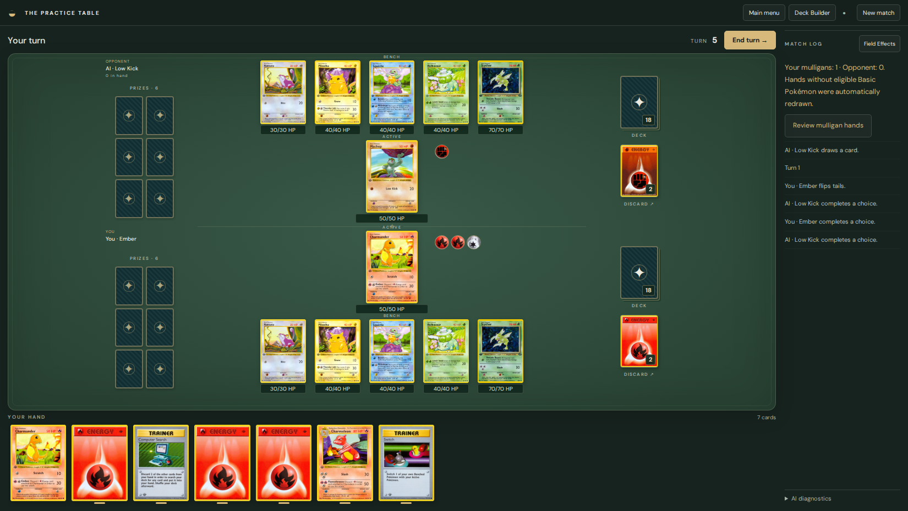
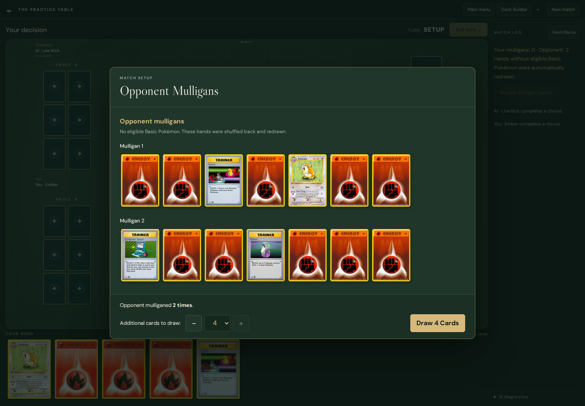

# Current game screenshots

All 74 screenshots were recaptured from the current application on 2026-10-14 06:12 UTC. Historical captures have been removed.

[Open the visual gallery](index.html)

Screenshots include normal gameplay and controlled engine-backed scenarios. Burn and Tool screenshots are explicitly display-only fixtures; those mechanics are not enabled in Base–Fossil. Click an image to open it at full size.

## Quick preview

## Tabletop and game zones

- [Deck discard 320](layout-correction/deck-discard-320.png) — 320×800
- [Deck discard 390](layout-correction/deck-discard-390.png) — 390×800
- [Finished empty active 1280](layout-correction/finished-empty-active-1280.png) — 1280×800
- [Finished empty active 1650](layout-correction/finished-empty-active-1650.png) — 1650×930
- [Finished empty active 320](layout-correction/finished-empty-active-320.png) — 320×800
- [Finished empty active 390](layout-correction/finished-empty-active-390.png) — 390×800
- [Finished empty active 760](layout-correction/finished-empty-active-760.png) — 760×800
- [Knockout replacement 1280](layout-correction/knockout-replacement-1280.png) — 1280×800
- [Prizes 320](layout-correction/prizes-320.png) — 320×800
- [Prizes 390](layout-correction/prizes-390.png) — 390×800
- [Table 1 bench 1280](layout-correction/table-1-bench-1280.png) — 1280×800
- [Table 1 bench 1650](layout-correction/table-1-bench-1650.png) — 1650×930
- [Table 1 bench 760](layout-correction/table-1-bench-760.png) — 760×800
- [Table 3 bench 1280](layout-correction/table-3-bench-1280.png) — 1280×800
- [Table 3 bench 1650](layout-correction/table-3-bench-1650.png) — 1650×930
- [Table 3 bench 760](layout-correction/table-3-bench-760.png) — 760×800
- [Table 5 bench 1280](layout-correction/table-5-bench-1280.png) — 1280×800
- [Table 5 bench 1650](layout-correction/table-5-bench-1650.png) — 1650×930
- [Table 5 bench 320](layout-correction/table-5-bench-320.png) — 320×800
- [Table 5 bench 390](layout-correction/table-5-bench-390.png) — 390×800
- [Table 5 bench 760](layout-correction/table-5-bench-760.png) — 760×800
- [Tabletop 1280](m4-tabletop-1280.png) — 1280×800
- [Tabletop 1280](tabletop-1280.png) — 1280×800
- [Tabletop](tabletop.png) — 1440×1000

## Mulligans

- [Mulligan both players](mulligan-both-players.png) — 1440×1000
- [Mulligan multiple 320](mulligan-multiple-320.png) — 320×650
- [Mulligan multiple 390](mulligan-multiple-390.png) — 390×650
- [Mulligan multiple 760](mulligan-multiple-760.png) — 760×650
- [Mulligan multiple desktop](mulligan-multiple-desktop.png) — 1440×1000
- [Mulligan single desktop](mulligan-single-desktop.png) — 1280×800

## Battlefield targeting

- [Targeting 1280 720](m4-targeting-1280-720.png) — 1280×720
- [Targeting 1280](m4-targeting-1280.png) — 1280×800
- [Targeting 1680](m4-targeting-1680.png) — 1680×1050
- [Targeting 320](m4-targeting-320.png) — 320×800
- [Targeting 390 667](m4-targeting-390-667.png) — 390×667
- [Targeting 390](m4-targeting-390.png) — 390×800
- [Targeting 760](m4-targeting-760.png) — 760×800

## Attachments and Special Conditions

- [Rotated resources 1280](layout-correction/rotated-resources-1280.png) — 1280×800
- [Rotated resources 1650](layout-correction/rotated-resources-1650.png) — 1650×930
- [Rotated resources 320](layout-correction/rotated-resources-320.png) — 320×800
- [Rotated resources 390](layout-correction/rotated-resources-390.png) — 390×800
- [Rotated resources 760](layout-correction/rotated-resources-760.png) — 760×800
- [Asleep 1280](m4-asleep-1280.png) — 1280×800
- [Asleep 320](m4-asleep-320.png) — 320×800
- [Asleep 390](m4-asleep-390.png) — 390×800
- [Asleep 760](m4-asleep-760.png) — 760×800
- [Burn tool display fixture (display-only fixture)](m4-burn-tool-display-fixture.png) — 1440×1000
- [Burn tool mobile display fixture (display-only fixture)](m4-burn-tool-mobile-display-fixture.png) — 320×800
- [Confused 1280](m4-confused-1280.png) — 1280×800
- [Confused 320](m4-confused-320.png) — 320×800
- [Confused 390](m4-confused-390.png) — 390×800
- [Confused 760](m4-confused-760.png) — 760×800
- [Paralyzed 1280](m4-paralyzed-1280.png) — 1280×800
- [Paralyzed 320](m4-paralyzed-320.png) — 320×800
- [Paralyzed 390](m4-paralyzed-390.png) — 390×800
- [Paralyzed 760](m4-paralyzed-760.png) — 760×800

## Effects and gameplay callouts

- [Attachment callout](m4-attachment-callout.png) — 1680×1050
- [Attack callout](m4-attack-callout.png) — 1440×1000
- [Coin callout](m4-coin-callout.png) — 1440×1000
- [Coin reveal](m4-coin-reveal.png) — 1440×1000
- [Field effects](m4-field-effects.png) — 1440×1000
- [Pokemon effects](m4-pokemon-effects.png) — 1440×1000
- [Trainer callout](m4-trainer-callout.png) — 1440×1000

## Card inspection and selection

- [Card actions mobile](card-actions-mobile.png) — 390×800
- [Card actions](card-actions.png) — 1280×800
- [Deck search](deck-search.png) — 1440×1000
- [Discard selection](discard-selection.png) — 1440×1000
- [Prize selection](prize-selection.png) — 1440×1000
- [Rain dance actions](rain-dance-actions.png) — 1440×1000
- [Retreat energy 1280](retreat-energy-1280.png) — 1280×800
- [Retreat energy 320](retreat-energy-320.png) — 320×800

## Deck builder

- [Deck builder desktop](deck-builder-desktop.png) — 1280×800
- [Deck builder mobile deck](deck-builder-mobile-deck.png) — 390×2151
- [Deck builder mobile](deck-builder-mobile.png) — 390×1297
